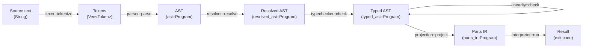
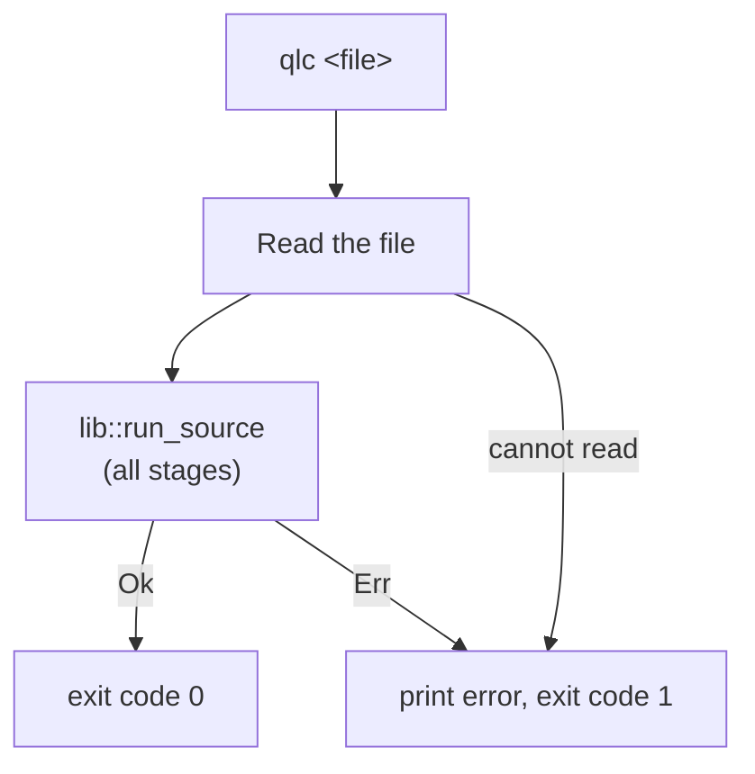

# Architecture

qlc reads one source file and executes it on the host.
The work is split in stages.
Each stage takes the output of the previous stage as input and produces a new representation.

This document describes what exists today. `specification.md` specifies the language as it is today.
`design.md` describes the language and compiler that qlc aims for.

## Stages

| Stage        | File                 | Input                   | Output                  |
|--------------|----------------------|-------------------------|-------------------------|
| Lexer        | `src/lexer.rs`       | source text             | `Vec<Token>`            |
| Parser       | `src/parser.rs`      | `&[Token]`              | `ast::Program`          |
| Resolver     | `src/resolver.rs`    | `ast::Program`          | `resolved_ast::Program` |
| Type checker | `src/typechecker.rs` | `resolved_ast::Program` | `typed_ast::Program`    |
| Linearity    | `src/linearity.rs`   | `&typed_ast::Program`   | `()`                    |
| Projection   | `src/projection.rs`  | `&typed_ast::Program`   | `parts_ir::Program`     |
| Interpreter  | `src/interpreter.rs` | `&parts_ir::Program`    | `()`                    |

The resolver checks the names of the program: function names must be unique,
there must be a `main` function, and each variable must be defined before it is used.
The resolved AST stores which function is `main`.
It refers to each variable by a `VariableId`, its index in its function, instead of its name.
Each function stores the name of each of its variables, indexed by its `VariableId`.
Several variables can have the same name. The names are used in error messages.

The type checker gives a type to each variable: the type of the value of its `let`.
The typed AST stores the name and the type of each variable of each function, indexed by its `VariableId`.
The types are in `src/types.rs`. Each type has a kind:

- `Data`: a value that can be copied and dropped.
- `Resource`: a value that must be used exactly once. It cannot be copied or dropped.

There are two types:

- `Int`, a 64-bit signed integer, of kind `Data`;
- `SimDevice`, a simulated device, of kind `Resource`.

The type checker checks that `print` gets an `Int` and `delete` gets a `SimDevice`.
Otherwise it reports a `TypeError::Mismatch`.

The linearity checker checks how resources are used. It only reads the typed AST.
Reading a variable whose type is of kind `Resource` moves its value,
for example in `delete(d)` or `let e = d;`.
A variable cannot be read after its value is moved.
Otherwise the linearity checker reports a `LinearityError::UseAfterMove`.
The value of each such variable must be moved before the end of its function.
Otherwise the linearity checker reports a `LinearityError::ValueNotUsed`.
So each resource is used exactly once.
It is a separate stage from the type checker, so that its algorithm can change
without changing the type checker. For example, branches will need a flow analysis.

The projection splits each function into **parts**, one for each place the function runs on.
A part is the code of a function that one place runs. A place is a participant that runs code.
Today the only place is the host, so each function has one part.
The parts IR refers to functions and variables by the same `FunctionId` and `VariableId` as the typed AST.
Each part stores its number of variables.

The interpreter runs the parts of `main` one after the other.
It uses the number of variables of a part to store their values in a `Vec`.
The interpreter also takes an output writer (`&mut impl Write`).
`print` writes to it.
The command line passes stdout, and the unit tests pass a `Vec<u8>` to check the output.

The AST types are in `src/ast.rs`. They are shared by the parser and the resolver.
The resolved AST types are in `src/resolved_ast.rs`. They are shared by the resolver and the type checker.
The typed AST types are in `src/typed_ast.rs`. They are shared by the type checker, the linearity checker and the projection.
The parts IR types are in `src/parts_ir.rs`. They are shared by the projection and the interpreter.
Each of these representations has its own types for functions, statements and expressions.
So each stage can store what it finds, and a stage does not depend on the representations of earlier stages.
The only exception is the ids `FunctionId` and `VariableId`: they are defined in `src/resolved_ast.rs`
and the typed AST and the parts IR use them too.

Each stage is one public function.
A stage only depends on the types of its input and output.
So the algorithm of a stage can be changed without changing the other stages.

## Errors

Each stage that can fail has its own error type: `LexError`, `ParseError`, `ResolveError`, `TypeError` and `LinearityError`.
`src/lib.rs` wraps them in one `Error` type.

There are two kinds of problems:

- **Errors in the user's program.** A stage returns an `Err`.
  As many checks as possible are done before the interpreter, so an error is reported before anything is printed.
  The interpreter cannot fail.
  The command line prints `error: <message>` on stderr and exits with code 1.
- **Bugs in qlc.** The code panics, with `expect` and a reason.
  Features that are not decided yet use `todo!`.
  Each representation checks its rules when it is built, in the constructors of its types.
  For example, `resolved_ast::Function::new` panics if a variable is read before it is set.
  So a bug is found in the stage that builds a wrong representation, not in a later stage.
  The rules of each representation are listed in the documentation of its module.

## Command line

`src/main.rs` only reads the file and reports the result.
All the language logic is in the library (`src/lib.rs` and the stage modules).

## Language

The syntax and the meaning of the language are in `specification.md`.

## Tests

- **Unit tests** are in each stage module. They test the stage function directly.
- **Integration tests** are in `tests/run_programs.rs`.
  They run the `qlc` binary on the files in `tests/programs/` and check only the exit code, stdout and stderr.
