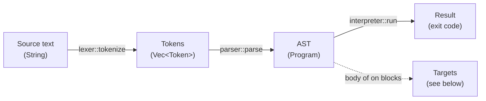
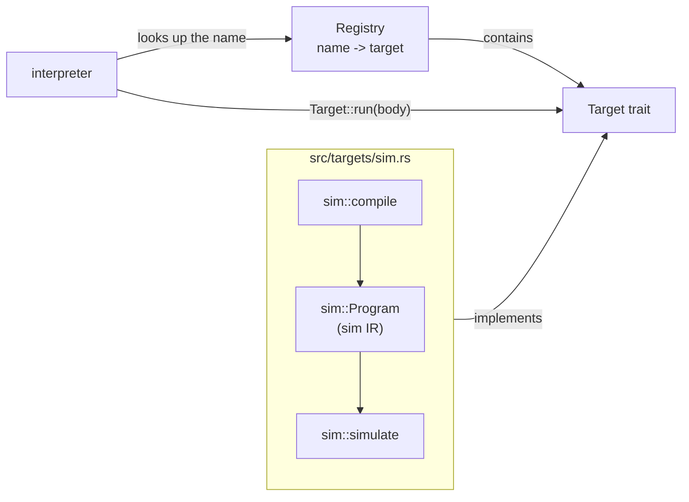
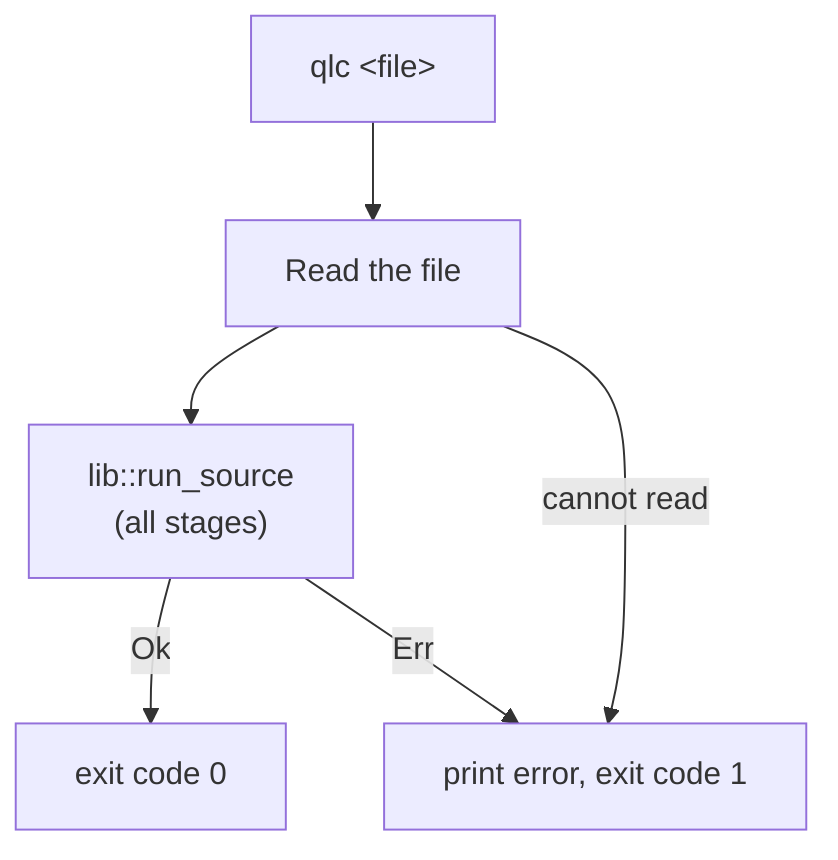

# Architecture

qlc reads one source file and executes it on the host.
Parts of the program, the `on` blocks, run on other devices, called targets.
The work is split in stages.
Each stage takes the output of the previous stage as input and produces a new representation.

## Stages



| Stage       | File                 | Input        | Output       |
|-------------|----------------------|--------------|--------------|
| Lexer       | `src/lexer.rs`       | source text  | `Vec<Token>` |
| Parser      | `src/parser.rs`      | `&[Token]`   | `Program`    |
| Interpreter | `src/interpreter.rs` | `&Program`   | `()`         |

The interpreter also takes the registry of targets and an output writer (`&mut impl Write`).
`print` writes to it.
The command line passes stdout, and the unit tests pass a `Vec<u8>` to check the output.

The AST types are in `src/ast.rs`.
They are shared by the parser and the interpreter.

Each stage is one public function.
A stage only depends on the types of its input and output.
So the algorithm of a stage can be changed without changing the other stages.

## Targets

A target is a device that runs the body of `on` blocks, such as a sequencer, an FPGA or an ARTIQ kernel.
Today the only target is `sim`, a simulated device for tests.



| Item       | File                    | Role                                                       |
|------------|-------------------------|------------------------------------------------------------|
| `Target`   | `src/targets.rs`        | Generates a program for a device from a body, and runs it. |
| `Registry` | `src/targets.rs`        | Maps target names to targets.                              |
| `sim`      | `src/targets/sim.rs`    | A simulated device with its own IR.                        |

Rules:

- The interpreter only knows the `Target` trait and the `Registry`. It never uses the IR of a target.
- Each target owns its IR, its code generation and its execution.
  To add a device, add a module in `src/targets/` and one line in `Registry::builtin`.
- The registry is a parameter of `interpreter::run`, not a global.
  `lib::run_source` passes `Registry::builtin()`, and the interpreter tests pass a registry with a fake target.
- A target receives the AST of the block body. This may change to a shared device IR when there are several targets.

`sim` works in two steps, which can be tested separately:
`sim::compile` generates a `sim::Program`, and `sim::simulate` runs it.
`sim::Program` can be printed as text, one instruction per line, to check the generated code.
Each line that `sim` prints starts with `sim: `.

Not supported yet: an `on` block inside another `on` block (a device that runs code on another device).

## Errors

Each stage has its own error type: `LexError`, `ParseError` and `RunError`.
`src/lib.rs` wraps them in one `Error` type.

There are two kinds of problems:

- **Errors in the user's program.** A stage returns an `Err`.
  The interpreter checks the program before running it, so an error is reported before anything is printed.
  The command line prints `error: <message>` on stderr and exits with code 1.
- **Bugs in qlc.** The code panics, with `expect` and a reason.
  Features that are not decided yet use `todo!`.

## Command line



`src/main.rs` only reads the file and reports the result.
All the language logic is in the library (`src/lib.rs` and the stage modules).

## Language

The language currently supports functions without parameters.
A function body is a list of statements:

```text
program   = function*
function  = "fn" identifier "(" ")" block
block     = "{" statement* "}"
statement = print | on
print     = "print" "(" integer ")" ";"
on        = "on" identifier block
```

An integer is a sequence of ASCII digits whose value fits in an `i64`.
`print` writes the integer on its own line on stdout.

A program must contain exactly one function named `main`.
Function names must be unique.
Running a program calls `main`.

`on <target> { ... }` runs its body on the target named `<target>`.
The target must exist, even if the block is in a function that is never called.

## Tests

- **Unit tests** are in each stage module. They test the stage function directly.
  The interpreter tests use a fake target, so they do not depend on `sim`.
- **Integration tests** are in `tests/run_programs.rs`.
  They run the `qlc` binary on the files in `tests/programs/` and check only the exit code, stdout and stderr.
