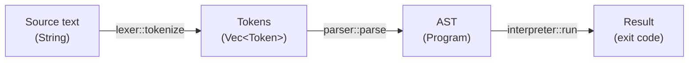
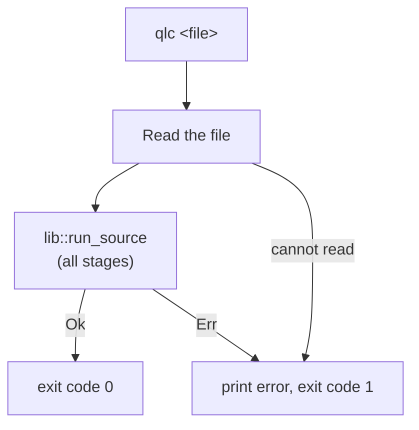

# Architecture

qlc reads one source file and executes it.
The work is split in stages.
Each stage takes the output of the previous stage as input and produces a new representation.

## Stages



| Stage       | File                 | Input        | Output       |
|-------------|----------------------|--------------|--------------|
| Lexer       | `src/lexer.rs`       | source text  | `Vec<Token>` |
| Parser      | `src/parser.rs`      | `&[Token]`   | `Program`    |
| Interpreter | `src/interpreter.rs` | `&Program`   | `()`         |

The AST types are in `src/ast.rs`.
They are shared by the parser and the interpreter.

Each stage is one public function.
A stage only depends on the types of its input and output.
So the algorithm of a stage can be changed without changing the other stages.

## Errors

Each stage has its own error type: `LexError`, `ParseError` and `RunError`.
`src/lib.rs` wraps them in one `Error` type.

There are two kinds of problems:

- **Errors in the user's program.** A stage returns an `Err`.
  The command line prints `error: <message>` on stderr and exits with code 1.
- **Bugs in qlc.** The code panics, with `expect` and a reason.
  Features that are not decided yet use `todo!`.

## Command line



`src/main.rs` only reads the file and reports the result.
All the language logic is in the library (`src/lib.rs` and the stage modules).

## Language

The language currently supports only empty functions without parameters:

```text
program  = function*
function = "fn" identifier "(" ")" "{" "}"
```

A program must contain exactly one function named `main`.
Function names must be unique.
Running a program calls `main`.

## Tests

- **Unit tests** are in each stage module. They test the stage function directly.
- **Integration tests** are in `tests/run_programs.rs`.
  They run the `qlc` binary on the files in `tests/programs/` and check only the exit code, stdout and stderr.
