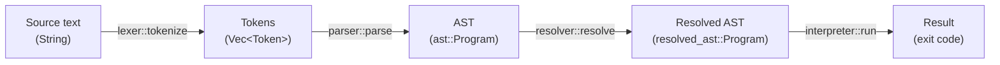
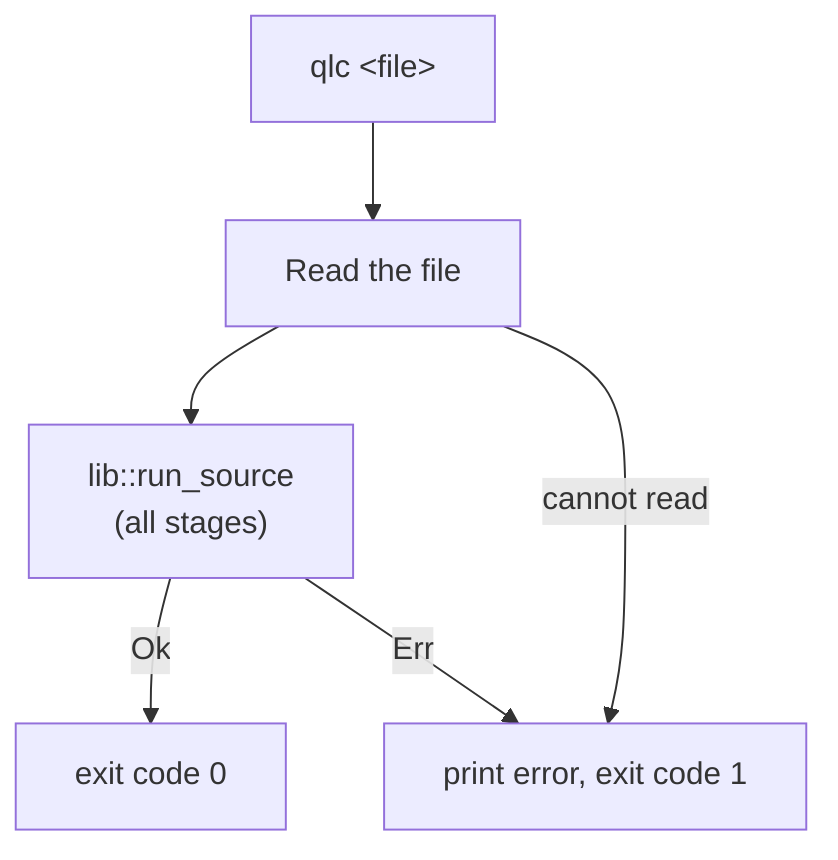

# Architecture

qlc reads one source file and executes it on the host.
The work is split in stages.
Each stage takes the output of the previous stage as input and produces a new representation.

This document describes what exists today. `design.md` describes the language and compiler that qlc aims for.

## Stages



| Stage       | File                 | Input                    | Output                  |
|-------------|----------------------|--------------------------|-------------------------|
| Lexer       | `src/lexer.rs`       | source text              | `Vec<Token>`            |
| Parser      | `src/parser.rs`      | `&[Token]`               | `ast::Program`          |
| Resolver    | `src/resolver.rs`    | `ast::Program`           | `resolved_ast::Program` |
| Interpreter | `src/interpreter.rs` | `&resolved_ast::Program` | `()`                    |

The resolver checks the names of the program: function names must be unique,
there must be a `main` function, and each variable must be defined before it is used.
The resolved AST stores which function is `main`.
It refers to each variable by a `VariableId`, its index in its function, instead of its name.
Each function stores its number of variables, so the interpreter can store their values in a `Vec`.

The interpreter also takes an output writer (`&mut impl Write`).
`print` writes to it.
The command line passes stdout, and the unit tests pass a `Vec<u8>` to check the output.

The AST types are in `src/ast.rs`. They are shared by the parser and the resolver.
The resolved AST types are in `src/resolved_ast.rs`. They are shared by the resolver and the interpreter.
The resolved AST has its own types for functions, statements and expressions, separate from the AST.
So the resolver can store what it finds about names, and the interpreter does not depend on the AST.

Each stage is one public function.
A stage only depends on the types of its input and output.
So the algorithm of a stage can be changed without changing the other stages.

## Errors

Each stage that can fail has its own error type: `LexError`, `ParseError` and `ResolveError`.
`src/lib.rs` wraps them in one `Error` type.

There are two kinds of problems:

- **Errors in the user's program.** A stage returns an `Err`.
  As many checks as possible are done before the interpreter, so an error is reported before anything is printed.
  The interpreter cannot fail.
  The command line prints `error: <message>` on stderr and exits with code 1.
- **Bugs in qlc.** The code panics, with `expect` and a reason.
  Features that are not decided yet use `todo!`.

## Command line



`src/main.rs` only reads the file and reports the result.
All the language logic is in the library (`src/lib.rs` and the stage modules).

## Language

The language currently supports functions without parameters.
A function body is a list of statements:

```text
program    = function*
function   = "fn" identifier "(" ")" block
block      = "{" statement* "}"
statement  = print | let
print      = "print" "(" expression ")" ";"
let        = "let" identifier "=" expression ";"
expression = integer | identifier
```

An integer is a sequence of ASCII digits whose value fits in an `i64`.
An expression is an integer literal or the name of a variable.
`print` writes the value of the expression on its own line on stdout.

`let x = <expression>;` defines a variable `x` with the value of the expression.
A variable can be used after its `let`, until the end of the function.
A `let` can reuse the name of a variable. It then defines a new variable,
and the name refers to the new variable after this `let`.
In `let x = x;`, the value refers to the previous `x`.

A program must contain exactly one function named `main`.
Function names must be unique.
Running a program calls `main`.

## Tests

- **Unit tests** are in each stage module. They test the stage function directly.
- **Integration tests** are in `tests/run_programs.rs`.
  They run the `qlc` binary on the files in `tests/programs/` and check only the exit code, stdout and stderr.
