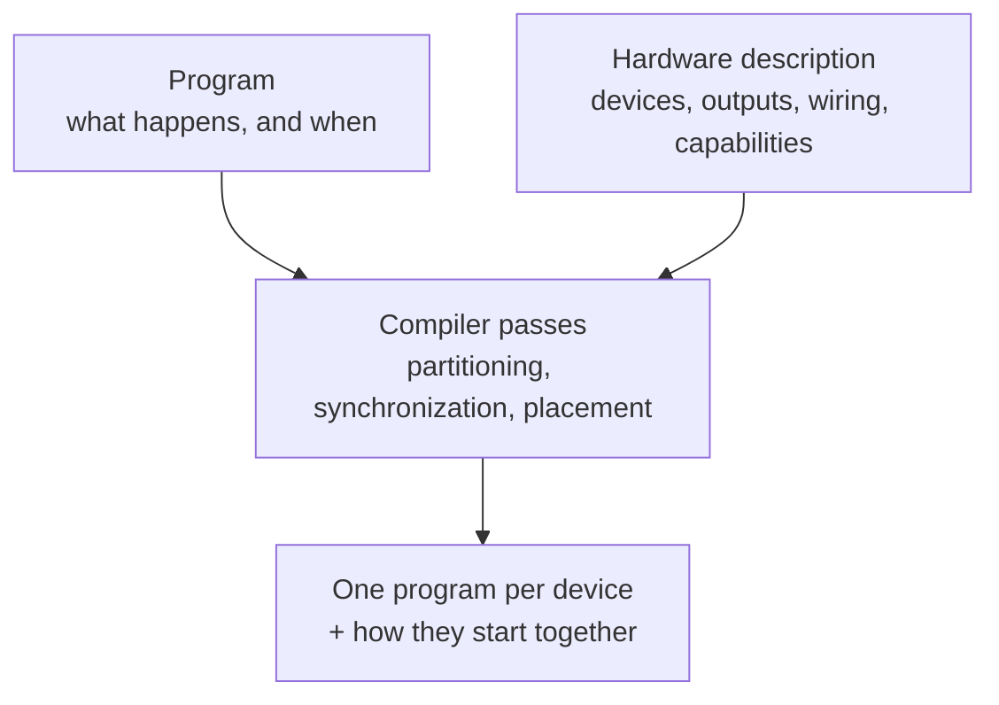
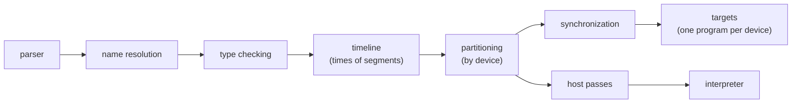

# Design

This document describes the language and compiler that qlc aims for.
Most of it is not implemented yet.
`architecture.md` describes what exists today.

## Goals

- A program runs on the host. The host generates programs for other devices:
  sequencers, FPGAs, ARTIQ kernels, DDS, GPUs, ...
- This can be chained: a device can generate programs for another device.
  For example, an ARTIQ kernel can generate programs for a DDS.
- Code for several devices can be written interleaved, in the order of time,
  or grouped by device. Both forms mean the same thing.
- Concurrency is structured: blocks start threads of control, and these threads end with their block.
- The syntax does not force how devices are started together (triggering),
  or how code is split into device programs. The compiler chooses this from a description of the hardware.

## Three layers



1. **The program** says what the outputs do and when.
   It does not say how devices are triggered or which device programs which.
2. **The hardware description** lists:
   - the devices and their kinds;
   - the outputs of each device, and their types (`Ttl`, `Dds`, ...);
   - what each device can do: run timed events, wait for a trigger, send a trigger,
     generate programs for another device;
   - the wiring, for example "TTL output 3 goes to the trigger input of the DDS".

   At first it is Rust code next to the target registry. Later it can be a file.
3. **The compiler passes** choose how to run the program on this hardware.
   Each pass has an interface, so that its algorithm can be replaced.
   A simple strategy comes first, and better ones can be added later.

The same program can run on two setups with different wiring, without any change.

## Time

The host has no notion of time. Only devices have one.
Time advances only through statements that drive outputs.
There is no `delay` statement that is not attached to an output or a step.

### Level semantics

An output statement sets an output to a value **for a duration**:

```text
ttl0.high(100);
ttl0.low(50);       // starts at t = 100, ends at t = 150
```

The compiler turns the start of each segment into an event for the device.

Compared to state statements (`set_high()` followed by `delay(100)`), level statements:

- show the value of an output where its time is described;
- give each block a duration that follows from its content;
- let the compiler detect two branches that drive the same output at the same time.

### Composition

- **Sequence.** Statements in a block run one after the other. The duration of the block is the sum of their durations.
- **`parallel { A B C }`.** The branches start at the same time.
  The block ends when its longest branch ends. Each branch is a thread of control.
- **`step(d) { ... }`.** The outputs set in the block hold their value for the duration `d`.
  It reads like one row of a step table:

  ```text
  step(100) {
      dds0.frequency(10);
      ttl0.high();
  }
  step(50) {
      dds0.frequency(20);
      ttl0.low();
  }
  ```

- **`hold <output> <value> { ... }`.** The output keeps a value during the whole block.
  It is used for outputs that stay in one state while other things happen:

  ```text
  hold shutter high {
      step(100) { ... }
      step(50) { ... }
  }
  ```

These blocks can be nested.

### Same meaning, two forms

These two programs give the same device programs:

```text
// Interleaved, in the order of time.
step(100) { dds0.frequency(10); ttl0.high(); }
step(50)  { dds0.frequency(20); ttl0.low(); }

// Grouped by output.
parallel {
    sequence { dds0.frequency(10, 100); dds0.frequency(20, 50); }
    sequence { ttl0.high(100);          ttl0.low(50); }
}
```

```text
dds0:  t=0 frequency 10    t=100 frequency 20
ttl0:  t=0 high            t=100 low
```

## Where code runs

### The host builds the device programs

Host code between timed statements runs on the host, before the devices start.
It decides which timed statements are added to the device programs.

```text
for i in 0..3 {
    step(10) { dds0.frequency(i); }
}
```

The host runs the loop and adds three segments to the program of `dds0`:
`t=0 frequency 0`, `t=10 frequency 1`, `t=20 frequency 2`.

### `on` blocks

`on <device> { ... }` says that the code of the block runs on a device.
Its statements are placed at the current time.
The compiler fuses all the code for one device into one program, in the order of time.
So many small `on` blocks can be interleaved with code for other devices.

`on` is needed when a device computes something itself, for example an ARTIQ kernel.
For output statements alone, the output already gives the device.

### Values from the host

A host value used in device code is a **parameter** of the device program.
The target compiles the code once, with parameters.
At runtime, the host calls the compiled program with the values of the parameters.

```text
let n = 2 * 21;
on sim { print(n); }
```

```text
sim program:  print param 0
call:         param 0 = 42
```

A target that cannot handle parameters can wait for the values and generate its program at the call.
The interface between the host and the targets allows both.

## Functions

Functions do not have to name a device.

- **Computation functions** run where they are called.
  The compiler compiles them for each target that calls them.
  If a target cannot run a function, the target reports an error, with the call chain.

  ```text
  fn scaled(f) { return 2 * f + 1; }

  step(100) { dds0.frequency(scaled(10)); }   // compiled for the DDS
  print(scaled(10));                           // run on the host
  ```

- **Functions that drive outputs** take the outputs as parameters.
  The device comes from the arguments, so the same function works for all outputs of a type.

  ```text
  fn pulse(out: Ttl, duration) {
      out.high(duration);
  }

  parallel {
      pulse(ttl0, 100);
      pulse(ttl3, 50);
  }
  ```

- **An optional annotation** documents a function and is checked by the compiler.
  It does not change the meaning of the program.

  ```text
  fn cooling_sequence() on artiq { ... }
  ```

The compiler infers, for each function, which outputs it drives.
It uses this to check `parallel` blocks and to know which target compiles which code.

## Compiler stages



- **Name resolution and type checking** come first.
  All errors in the user's program are reported before any target compiles,
  because a target compile can be slow (an FPGA build can take minutes).
  Type checking also infers which outputs each function drives.
- **Partitioning** groups the code by device. It generalizes the current outliner:
  today one `on` block gives one kernel; then one region gives one kernel per device it uses.
- **Synchronization** chooses how the device programs start together, from the hardware description.
  Possible strategies:
  - the host starts all devices (simple, not precise);
  - one device sends a trigger to the others;
  - an external trigger starts all devices;
  - a coordinating device emits the events of the others (chaining).

  It gives each target a **role**, for example "wait for trigger input 1"
  or "send a trigger on output 3 at start". The target checks that it can play this role.
- **Targets** receive the timed actions for their device and their role, and compile them.
- **Host passes** only see calls to device programs. They never change device code.

## Related systems

| System | Kind of output statement | How time advances |
|---|---|---|
| ARTIQ | state (`ttl.on()`), plus `pulse` | `delay` moves one time cursor per kernel; `with parallel` |
| labscript | state (`go_high(t)`), plus ramps | absolute time as an argument; the user moves `t` by hand |
| Qiskit Pulse, QUA | level (`play` has a duration) | statements with a duration; delays belong to channels; align blocks |
| qlc | level, with `step` and `hold` | statements with a duration; `sequence`, `parallel` |

The labscript connection table plays the role of our hardware description:
it describes devices, clocks and triggers, and the compiler uses it to generate one table per device.

## Open questions

1. **Value after the last segment.** Does an output keep its last value,
   or return to a default value declared in the hardware description?
   A default is safer, because a forgotten output does not stay on.
2. **Outputs not set in a `step`.** Do they keep their value, or return to their default?
3. **Syntax of actions in `on` blocks.** Inside `on dds0 { ... }`, is `frequency(10)` allowed as a short form of
   `dds0.frequency(10)`, or is the output always written?
4. **State statements.** Should `ttl0.set(high)` exist, as a short form of
   "this level until the end of the enclosing block"?
5. **Data between devices during the run.** For example, a measurement on one device that decides an action on another.
   This needs communication and has latency limits. It is not allowed at first.
6. **Units.** Durations and frequencies need units (`100 us`, `10 MHz`).
7. **Instantaneous events,** such as a trigger edge. Do they have a minimum duration, or a duration of zero?
