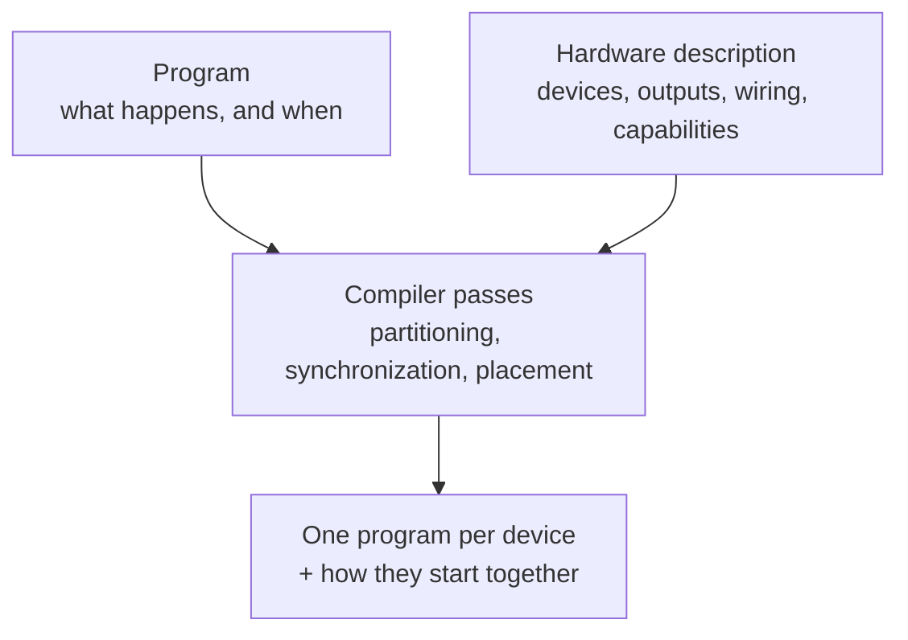
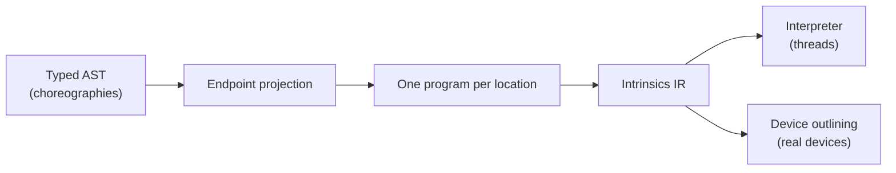
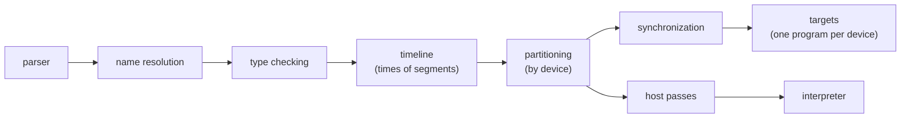

# Design

This document describes the language and compiler that qlc aims for.
Most of it is not implemented yet.
`architecture.md` describes what exists today.

## Goals

- A program runs on the host. The host generates programs for other devices:
  sequencers, FPGAs, ARTIQ kernels, DDS, GPUs, ...
- This can be chained: a device can generate programs for another device.
  For example, an ARTIQ kernel can generate programs for a DDS.
- Code for several devices can be written interleaved, in the order of time,
  or grouped by device. Both forms mean the same thing.
- Concurrency is structured: blocks start threads of control, and these threads end with their block.
- The syntax does not force how devices are started together (triggering),
  or how code is split into device programs. The compiler chooses this from a description of the hardware.

## Three layers



1. **The program** says what the outputs do and when.
   It does not say how devices are triggered or which device programs which.
2. **The hardware description** lists:
   - the devices and their kinds;
   - the outputs of each device, and their types (`Ttl`, `Dds`, ...);
   - what each device can do: run timed events, wait for a trigger, send a trigger,
     generate programs for another device;
   - the wiring, for example "TTL output 3 goes to the trigger input of the DDS".

   At first it is Rust code next to the target registry. Later it can be a file.
3. **The compiler passes** choose how to run the program on this hardware.
   Each pass has an interface, so that its algorithm can be replaced.
   A simple strategy comes first, and better ones can be added later.

The same program can run on two setups with different wiring, without any change.

## Time

The host has no notion of time. Only devices have one.
Time advances only through statements that drive outputs.
There is no `delay` statement that is not attached to an output or a step.

### Level semantics

An output statement sets an output to a value **for a duration**:

```text
ttl0.high(100);
ttl0.low(50);       // starts at t = 100, ends at t = 150
```

The compiler turns the start of each segment into an event for the device.

Compared to state statements (`set_high()` followed by `delay(100)`), level statements:

- show the value of an output where its time is described;
- give each block a duration that follows from its content;
- let the compiler detect two branches that drive the same output at the same time.

### Composition

- **Sequence.** Statements in a block run one after the other. The duration of the block is the sum of their durations.
- **`parallel { A B C }`.** The branches start at the same time.
  The block ends when its longest branch ends. Each branch is a thread of control.
- **`step(d) { ... }`.** The outputs set in the block hold their value for the duration `d`.
  It reads like one row of a step table:

  ```text
  step(100) {
      dds0.frequency(10);
      ttl0.high();
  }
  step(50) {
      dds0.frequency(20);
      ttl0.low();
  }
  ```

- **`hold <output> <value> { ... }`.** The output keeps a value during the whole block.
  It is used for outputs that stay in one state while other things happen:

  ```text
  hold shutter high {
      step(100) { ... }
      step(50) { ... }
  }
  ```

These blocks can be nested.

### Same meaning, two forms

These two programs give the same device programs:

```text
// Interleaved, in the order of time.
step(100) { dds0.frequency(10); ttl0.high(); }
step(50)  { dds0.frequency(20); ttl0.low(); }

// Grouped by output.
parallel {
    sequence { dds0.frequency(10, 100); dds0.frequency(20, 50); }
    sequence { ttl0.high(100);          ttl0.low(50); }
}
```

```text
dds0:  t=0 frequency 10    t=100 frequency 20
ttl0:  t=0 high            t=100 low
```

## Where code runs

### The host builds the device programs

Host code between timed statements runs on the host, before the devices start.
It decides which timed statements are added to the device programs.

```text
for i in 0..3 {
    step(10) { dds0.frequency(i); }
}
```

The host runs the loop and adds three segments to the program of `dds0`:
`t=0 frequency 0`, `t=10 frequency 1`, `t=20 frequency 2`.

### `on` blocks

This section is not decided. A first version of `on` blocks was implemented and then removed,
because it was not clear how they should work.
The section [Choreographies](#choreographies) describes another way to place code on devices.

`on <device> { ... }` says that the code of the block runs on a device.
Its statements are placed at the current time.
The compiler fuses all the code for one device into one program, in the order of time.
So many small `on` blocks can be interleaved with code for other devices.

`on` is needed when a device computes something itself, for example an ARTIQ kernel.
For output statements alone, the output already gives the device.

### Values from the host

A host value used in device code is a **parameter** of the device program.
The target compiles the code once, with parameters.
At runtime, the host calls the compiled program with the values of the parameters.

```text
let n = 2 * 21;
on sim { print(n); }
```

```text
sim program:  print param 0
call:         param 0 = 42
```

A target that cannot handle parameters can wait for the values and generate its program at the call.
The interface between the host and the targets allows both.

## Choreographies

A **choreography** is a function that describes what several devices do together, in one body.
It is declared with `prog`. The compiler splits it into one program per device.
This step is called **endpoint projection**.

```text
prog my_prog(on t1: Thread, on t2: Thread) {
    let x@t1 = 42;
    let val = send(t1, t2, x);
    print(val);
}
```

Thread `t1` sends 42 to thread `t2`, and `t2` prints it.

At first, the devices are threads on the host. Later they are real devices, with timed outputs.

### Locations

- A **location** is a device that takes part in a choreography.
- The location parameters of a `prog` are written with `on`, for example `on t1: Thread`.
- The type of a location is a device type. At first, `Thread` is the only one.
  Later, a location can have any type that implements a `Device` trait.
- Inside a `prog`, a location is a name known at compile time. It is not a runtime value.
  The compiler needs the locations to project the choreography.
- On the host, a device is a handle of kind Resource. The host uses it to communicate with the device.

### Located values

- Each variable has a type and a location. For example, `x: Int@t1` is an `Int` available on `t1`.
- A `let` can give the location of its variable: `let x@t1 = 42;`.
  Otherwise, the location comes from the expression, for example the result of `send`.
- A value can only be used on its location.
  Using a value on another location is a type error.
- At first, each value has one location.
  Later, a value can be available on several locations: `x@(t1, t2)`.

### Calls inside a `prog`

- A function called inside a `prog` must itself be a `prog`.
  Its location parameters are set to locations of the caller.
- A `fn` is a `prog` whose only location is the host.
  The host location is not written, so a `fn` is called like a usual function.
  It runs on the host, and cannot be called on another location.
- The builtins are `prog`s too:

  | Builtin | Signature |
  |---|---|
  | `send` | `prog send(on from: Thread, on to: Thread, x: Int@from) -> Int@to` |
  | `print` | `prog print(on d: Thread, x: Int@d)` |

- `print(val)` runs on the location of `val`. The location argument is not written.
- At first, only `Int` values can be sent. Resources cannot be sent.

### Projection

Projection gives each location the statements that it runs.
A `send` gives a send on one side and a receive on the other side.

```text
t1:  let x = 42;  send(t2, x);
t2:  let val = recv(t1);  print(val);
```

The program of each location only uses its own values.
Each send in one program has a matching receive in the other program.
So a choreography that type checks cannot deadlock and cannot read a value that is not on its location.
This follows the rule that a function that type checks does not fail when it is called.

### Compilation



- Projection is the partitioning pass of [Compiler stages](#compiler-stages), for choreographies.
- The programs of the locations are lowered to an **intrinsics IR**.
  It has a small set of operations, such as `let`, `print`, `send` and `recv`.
- The interpreter runs the intrinsics IR for threads.
  A device outlining stage extracts the code of real devices and gives it to their targets.

### Running a choreography from the host

The host gets one part per location, starts each part on a thread, and waits for the threads to end:

```text
let p1, p2 = parts(my_prog);

let t1 = thread(p1);
let t2 = thread(p2);

join(t1);
join(t2);
```

The parts and the thread handles are of kind Resource.
So the linearity checker checks that each part is started once and each thread is joined once.
This follows the rule that threads end with their block.

This needs function values and tuples, which do not exist yet.
So the first version does not have it: `main` is a `prog`, and qlc creates one thread for each of its locations.

```text
prog main(on t1: Thread, on t2: Thread) {
    let x@t1 = 42;
    let val = send(t1, t2, x);
    print(val);
}
```

### First steps

Each step is a separate change, with its own tests.

1. **Syntax.** The lexer and the parser accept `prog`, `on` parameters, `@` annotations and `send`.
2. **Resolver.** Location names are resolved in their own namespace. An unknown location is an error.
3. **Type checker.** Each variable gets a type and a location. Using a value on another location is an error.
4. **Projection.** A new stage gives one program per location.
5. **Execution.** The interpreter runs the program of each location.
   At first it runs them one after the other on one OS thread, and switches location when one waits for a receive.
   So the output is always the same, and the integration tests can check it.
   Real threads can come later.
6. **Host side.** `parts`, `thread` and `join`.

### Open questions about choreographies

1. **Location of literals.** Can the location of `42` in `send(t1, t2, 42)` be inferred from its use?
2. **Values on several locations.** Is `x@(t1, t2)` computed on each location, or computed on one and sent to the others?
3. **Branches.** In an `if` on `t1`, `t2` must know which branch is taken.
   Does the compiler add the messages, or must the program send them?
4. **Resources.** Can a resource be sent to another location? Is a device handle a value on a location?
5. **Values from the host.** How does the host pass values to a `prog`? See [Values from the host](#values-from-the-host).
6. **Time.** How do choreographies combine with timed statements, `parallel` and `step`?
7. **Outputs.** How do outputs relate to locations?
   Is a function that drives an output, such as `pulse` in [Functions](#functions), a `prog` on the device of the output?

## Functions

A `fn` is a `prog` with one location: the host.
The host location is not written, so a `fn` is called without special syntax.
Code that runs on a device is in a `prog`. See [Choreographies](#choreographies).

- **Computation functions** that run on devices are `prog`s with one location parameter.
  The compiler compiles them for each location they are called on.
  If a device cannot run a function, its target reports an error, with the call chain.

  ```text
  prog scaled(on d: Device, f: Int@d) -> Int@d { return 2 * f + 1; }

  step(100) { dds0.frequency(scaled(10)); }   // compiled for the DDS
  ```

  A computation that only runs on the host is a `fn`:

  ```text
  fn scaled_on_host(f: Int) -> Int { return 2 * f + 1; }

  print(scaled_on_host(10));
  ```

- **Functions that drive outputs** take the outputs as parameters.
  The device comes from the arguments, so the same function works for all outputs of a type.

  ```text
  fn pulse(out: Ttl, duration) {
      out.high(duration);
  }

  parallel {
      pulse(ttl0, 100);
      pulse(ttl3, 50);
  }
  ```

- **An optional annotation** documents a function and is checked by the compiler.
  It does not change the meaning of the program.

  ```text
  fn cooling_sequence() on artiq { ... }
  ```

The compiler infers, for each function, which outputs it drives.
It uses this to check `parallel` blocks and to know which target compiles which code.

## Compiler stages



- **Name resolution and type checking** come first.
  All errors in the user's program are reported before any target compiles,
  because a target compile can be slow (an FPGA build can take minutes).
  Type checking also infers which outputs each function drives.
- **Partitioning** groups the code by device. One region gives one device program per device it uses.
- **Synchronization** chooses how the device programs start together, from the hardware description.
  Possible strategies:
  - the host starts all devices (simple, not precise);
  - one device sends a trigger to the others;
  - an external trigger starts all devices;
  - a coordinating device emits the events of the others (chaining).

  It gives each target a **role**, for example "wait for trigger input 1"
  or "send a trigger on output 3 at start". The target checks that it can play this role.
- **Targets** receive the timed actions for their device and their role, and compile them.
- **Host passes** only see calls to device programs. They never change device code.

## Related systems

| System | Kind of output statement | How time advances |
|---|---|---|
| ARTIQ | state (`ttl.on()`), plus `pulse` | `delay` moves one time cursor per kernel; `with parallel` |
| labscript | state (`go_high(t)`), plus ramps | absolute time as an argument; the user moves `t` by hand |
| Qiskit Pulse, QUA | level (`play` has a duration) | statements with a duration; delays belong to channels; align blocks |
| qlc | level, with `step` and `hold` | statements with a duration; `sequence`, `parallel` |

The labscript connection table plays the role of our hardware description:
it describes devices, clocks and triggers, and the compiler uses it to generate one table per device.

## Open questions

1. **Value after the last segment.** Does an output keep its last value,
   or return to a default value declared in the hardware description?
   A default is safer, because a forgotten output does not stay on.
2. **Outputs not set in a `step`.** Do they keep their value, or return to their default?
3. **Syntax of actions in `on` blocks.** Inside `on dds0 { ... }`, is `frequency(10)` allowed as a short form of
   `dds0.frequency(10)`, or is the output always written?
4. **State statements.** Should `ttl0.set(high)` exist, as a short form of
   "this level until the end of the enclosing block"?
5. **Data between devices during the run.** For example, a measurement on one device that decides an action on another.
   This needs communication and has latency limits. It is not allowed at first.
6. **Units.** Durations and frequencies need units (`100 us`, `10 MHz`).
7. **Instantaneous events,** such as a trigger edge. Do they have a minimum duration, or a duration of zero?
